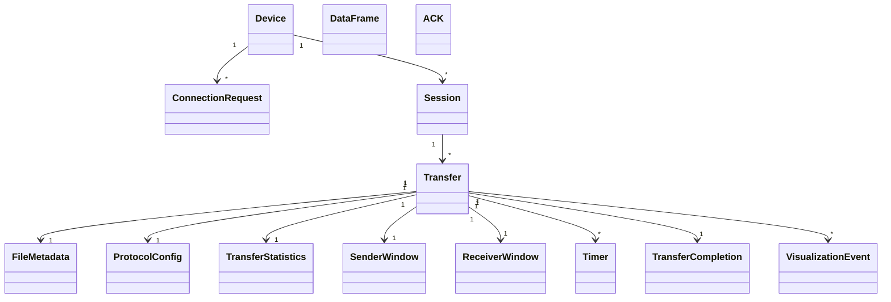

# DATA_MODEL.md

# Data Model – Laptop-to-Laptop File Transfer System

## 1. Overview

This document defines the logical data structures used by the Laptop-to-Laptop File Transfer System.

The application uses a modular monolithic architecture with Python and FastAPI on the backend and React on the frontend.

The system uses:

* UDP for file data transmission and acknowledgements.
* HTTP over TCP for peer communication and session management.
* WebSockets for real-time frontend updates.
* In-memory Python data structures for application state.
* Local filesystem storage for selected and received files.

### 1.1 General Conventions

* UUIDs are used for device, session, transfer and file identifiers at the application level.
* Timestamps use UTC ISO-8601 format.
* Binary network frames use fixed-width fields.
* CRC32 is used for individual frame integrity.
* SHA-256 is used for complete file integrity.
* The default file chunk size is 1024 bytes.
* The sequence number field is 16 bits for Go-Back-N and Selective Repeat.
* Stop-and-Wait uses alternating sequence numbers 0 and 1.
* The MVP supports one active transfer per session.
* The MVP file-size limit is 5 MB.

**Important:** These are logical application models. The actual byte-level representation of UDP frames will be defined separately in `WIRE_PROTOCOL.md`.

---

# 2. Device Model

Represents a laptop running the application.

Each device can operate as either a Sender or Receiver during a session.

| Field            | Type     | Description                          |
| ---------------- | -------- | ------------------------------------ |
| device_id        | UUID     | Unique device identifier             |
| device_name      | String   | Device display name                  |
| ip_address       | String   | Local network IP address             |
| api_port         | Integer  | Backend peer API port                |
| udp_port         | Integer  | Local UDP communication port         |
| api_version      | String   | Backend API version                  |
| role             | Enum     | SENDER / RECEIVER                    |
| discovery_method | Enum     | ZEROCONF / MANUAL                    |
| status           | Enum     | ONLINE / OFFLINE / CONNECTED         |
| last_seen        | DateTime | Last successful device communication |

### Discovery Rules

* Only devices operating in Receiver mode advertise themselves through Zeroconf.
* Sender devices discover available receivers.
* Manual IP + PIN is available when Zeroconf discovery fails.
* Device information is maintained in memory.

---

# 3. Connection Request Model

Represents an incoming connection request from a Sender to a Receiver.

| Field              | Type     | Description                                      |
| ------------------ | -------- | ------------------------------------------------ |
| connection_id      | UUID     | Unique connection request ID                     |
| sender_device_id   | UUID     | Sender device identifier                         |
| sender_device_name | String   | Sender display name                              |
| sender_ip          | String   | Sender IP obtained from the network connection   |
| receiver_device_id | UUID     | Receiver device identifier                       |
| discovery_method   | Enum     | ZEROCONF / MANUAL                                |
| status             | Enum     | PENDING_APPROVAL / APPROVED / REJECTED / EXPIRED |
| requested_at       | DateTime | Request timestamp                                |
| expires_at         | DateTime | Request expiry timestamp                         |

### Connection Rules

1. Sender initiates the connection.
2. Receiver receives the connection request.
3. Receiver must approve or reject the request.
4. A successful approval allows session establishment.
5. PIN validation is required only for the manual IP + PIN connection path.

### PIN Rules

* PIN contains six digits.
* PIN expires after 120 seconds.
* PIN can be used only once.
* Maximum five failed attempts.
* After five failed attempts, further attempts are temporarily locked.
* PIN comparison should use constant-time comparison.

PINs should not be stored as permanent device properties.

---

# 4. Session Model

Represents an established connection between two devices.

A session has fixed roles: one Sender and one Receiver.

| Field              | Type     | Description                                      |
| ------------------ | -------- | ------------------------------------------------ |
| session_id         | UUID     | Unique session identifier                        |
| local_device_id    | UUID     | Current device identifier                        |
| peer_device_id     | UUID     | Connected peer identifier                        |
| local_role         | Enum     | SENDER / RECEIVER                                |
| local_ip           | String   | Current device IP                                |
| peer_ip            | String   | Peer IP                                          |
| local_api_port     | Integer  | Local backend port                               |
| peer_api_port      | Integer  | Peer backend port                                |
| local_udp_port     | Integer  | Local UDP port                                   |
| peer_udp_port      | Integer  | Peer UDP port                                    |
| session_token_hash | String   | Hash of the issued session token                 |
| status             | Enum     | CONNECTING / ESTABLISHED / DISCONNECTED / CLOSED |
| created_at         | DateTime | Session creation time                            |
| updated_at         | DateTime | Last session update                              |

### Session Rules

* Sender generates the session ID.
* Both devices maintain their own local session representation.
* Both devices open and bind their UDP sockets before file transmission.
* UDP port information is exchanged during session establishment.
* Receiver must be ready before the Sender starts transmitting.
* All peer transfer endpoints require a valid session token.
* The raw session token should not be stored in the session model.
* Heartbeat checks are used to detect peer disconnection.

---

# 5. File Metadata Model

Represents a file selected by the Sender or reconstructed by the Receiver.

| Field        | Type     | Description                         |
| ------------ | -------- | ----------------------------------- |
| file_id      | UUID     | Unique file identifier              |
| file_name    | String   | Original filename                   |
| file_path    | String   | Local filesystem path; backend only |
| file_size    | Integer  | File size in bytes                  |
| file_type    | String   | MIME type or file extension         |
| total_frames | Integer  | Total number of data frames         |
| chunk_size   | Integer  | Payload size per frame              |
| sha256_hash  | String   | Original file SHA-256 hash          |
| created_at   | DateTime | File selection timestamp            |

### File Rules

* Maximum file size: 5 MB.
* Default chunk size: 1024 bytes.
* File is divided into chunks before transmission.
* The original SHA-256 hash is calculated before transmission.
* The hash is shared with the Receiver in the transfer request.
* The Receiver calculates the hash after reconstructing the file.
* Local filesystem paths must never be exposed through peer APIs.
* Filenames must be sanitized before saving.
* Reject path traversal attempts such as `../../file.txt`.
* Handle filename collisions safely.
* Check available disk space before reconstruction.
* Empty files must also be supported; their total frame count is zero.

---

# 6. Transfer Model

Represents one file-transfer operation between two devices.

| Field               | Type           | Description                                                               |
| ------------------- | -------------- | ------------------------------------------------------------------------- |
| transfer_id         | UUID           | Unique transfer identifier                                                |
| session_id          | UUID           | Associated session                                                        |
| file_id             | UUID           | Associated file                                                           |
| protocol            | Enum           | STOP_AND_WAIT / GO_BACK_N / SELECTIVE_REPEAT                              |
| status              | Enum           | PENDING / ACCEPTED / READY / IN_PROGRESS / COMPLETED / FAILED / CANCELLED |
| configuration       | ProtocolConfig | Transfer-specific configuration                                           |
| total_frames        | Integer        | Total unique data frames                                                  |
| total_transmissions | Integer        | Total transmission attempts                                               |
| created_at          | DateTime       | Transfer creation time                                                    |
| started_at          | DateTime       | Transfer start time                                                       |
| completed_at        | DateTime       | Transfer completion time                                                  |
| failure_reason      | String         | Failure reason, if applicable                                             |
| integrity_verified  | Boolean        | Final SHA-256 verification result                                         |

### Transfer Rules

* One active transfer per session.
* Sender selects the protocol before sending the transfer request.
* Receiver can accept or reject the request.
* Receiver opens its UDP socket and confirms readiness.
* Sender starts transmission only after receiving the ready confirmation.
* Transfer configuration sent with the request takes precedence over saved application defaults.
* Transfer completion requires successful file reconstruction and integrity verification.

---

# 7. Protocol Configuration Model

Stores configuration for the selected ARQ protocol.

| Field                  | Type    | Description                                  |
| ---------------------- | ------- | -------------------------------------------- |
| protocol               | Enum    | STOP_AND_WAIT / GO_BACK_N / SELECTIVE_REPEAT |
| sender_window_size     | Integer | Sender sliding-window size                   |
| receiver_window_size   | Integer | Receiver sliding-window size                 |
| timeout_ms             | Integer | Retransmission timeout                       |
| max_retries            | Integer | Maximum retransmissions per frame            |
| packet_loss_percentage | Float   | Simulated packet-loss percentage             |
| frame_delay_ms         | Integer | Delay between frame transmissions            |
| loss_seed              | Integer | Seed for reproducible loss simulation        |
| sequence_number_bits   | Integer | Sequence-number width                        |
| payload_size           | Integer | Maximum data payload size                    |

### Initial Configuration

| Parameter       | Stop-and-Wait |  Go-Back-N | Selective Repeat |
| --------------- | ------------: | ---------: | ---------------: |
| Sender Window   |             1 |          4 |                4 |
| Receiver Window |             1 |          1 |                4 |
| Sequence Number |         1 bit |    16 bits |          16 bits |
| Timeout         |       1000 ms |    1000 ms |          1000 ms |
| Payload Size    |    1024 bytes | 1024 bytes |       1024 bytes |

Additional defaults:

* Maximum retransmissions: 5 initially.
* Frame delay: 100 ms.
* Packet-loss presets: 0%, 10%, 30%.

The retry count for the 30% loss preset should be validated through testing before being finalized.

### Configuration Rules

* Stop-and-Wait always uses a window size of 1.
* Go-Back-N receiver window size is 1.
* Selective Repeat sender and receiver windows must satisfy the half-sequence-space constraint.
* For 16-bit sequence numbers, the maximum Selective Repeat window size is 32768.
* Sequence numbers wrap around using modular arithmetic.
* `max_retries` means retransmissions after the initial transmission. Total attempts = retries + 1.

---

# 8. Data Frame Model

Represents a logical data frame transmitted through UDP.

| Field           | Type    | Description                |
| --------------- | ------- | -------------------------- |
| session_id      | UUID    | Associated session         |
| transfer_id     | UUID    | Associated transfer        |
| frame_type      | Enum    | DATA / FIN                 |
| sequence_number | Integer | Wire-level sequence number |
| frame_index     | Integer | Absolute frame index       |
| payload_length  | Integer | Payload length             |
| checksum        | Integer | CRC32 checksum             |
| payload         | Bytes   | Actual file chunk          |

### Important Distinction

`sequence_number` and `frame_index` serve different purposes.

* `sequence_number`: Protocol-level number that wraps around.
* `frame_index`: Absolute frame position that increases throughout the transfer.

For example:

| Frame            | Sequence Number | Frame Index |
| ---------------- | --------------: | ----------: |
| First            |               0 |           0 |
| Second           |               1 |           1 |
| Third            |               2 |           2 |
| ...              |             ... |         ... |
| After wraparound |               0 |       65536 |

Stop-and-Wait alternates between sequence numbers 0 and 1.

### Wire Protocol Requirements

The actual binary frame header must include:

* Magic identifier
* Protocol version
* Frame type
* Session identifier
* Transfer identifier
* Sequence number
* Absolute frame index
* Payload length
* CRC32 checksum
* Payload

The exact field widths, byte order and Python `struct` format strings will be defined in `WIRE_PROTOCOL.md`.

---

# 9. ACK Model

Represents an acknowledgement sent by the Receiver.

| Field       | Type    | Description             |
| ----------- | ------- | ----------------------- |
| session_id  | UUID    | Associated session      |
| transfer_id | UUID    | Associated transfer     |
| frame_type  | Enum    | ACK / FIN_ACK           |
| ack_number  | Integer | Acknowledgement number  |
| ack_type    | Enum    | INDIVIDUAL / CUMULATIVE |
| checksum    | Integer | CRC32 checksum          |

### ACK Rules

**Stop-and-Wait**

* Individual ACK.
* ACK echoes the sequence number of the correctly received frame.

**Go-Back-N**

* Cumulative ACK.
* ACK number represents the next expected sequence number.
* ACK 0 means no frames have been accepted yet.
* ACK 2 means frames 0 and 1 have been accepted.

**Selective Repeat**

* Individual ACK.
* ACK acknowledges a specific sequence number.
* Receiver can acknowledge frames received out of order.

---

# 10. Sender Window Model

Maintains the sender's sliding-window state.

| Field               | Type       | Description                                   |
| ------------------- | ---------- | --------------------------------------------- |
| base_sequence       | Integer    | Oldest unacknowledged sequence number         |
| next_sequence       | Integer    | Next sequence number to transmit              |
| base_frame_index    | Integer    | Absolute index of oldest unacknowledged frame |
| next_frame_index    | Integer    | Absolute index of next frame                  |
| window_size         | Integer    | Maximum outstanding frames                    |
| outstanding_frames  | Dictionary | Frames awaiting acknowledgement               |
| acknowledged_frames | Set        | Successfully acknowledged frame indices       |

### Rules

* Stop-and-Wait maintains one outstanding frame.
* Go-Back-N maintains multiple outstanding frames but uses one timer for the oldest unacknowledged frame.
* Selective Repeat maintains individual acknowledgement and timer state for each outstanding frame.
* Window movement follows the corresponding ARQ protocol.

---

# 11. Receiver Window Model

Maintains the receiver's sliding-window state.

| Field            | Type       | Description                            |
| ---------------- | ---------- | -------------------------------------- |
| base_sequence    | Integer    | Next expected sequence number          |
| base_frame_index | Integer    | Next expected absolute frame index     |
| window_size      | Integer    | Receiver window size                   |
| buffered_frames  | Dictionary | Out-of-order frames temporarily stored |
| received_frames  | Set        | Successfully received frame indices    |

### Rules

**Stop-and-Wait**

* Accept only the expected frame.
* Discard duplicates and resend the appropriate ACK.

**Go-Back-N**

* Accept only the next expected frame.
* Discard out-of-order frames.
* Send cumulative ACKs.

**Selective Repeat**

* Accept frames within the receiver window.
* Buffer out-of-order frames.
* Deliver buffered frames in order once missing frames arrive.
* Send individual ACKs.

---

# 12. Timer Model

Maintains retransmission timing information.

| Field       | Type     | Description                 |
| ----------- | -------- | --------------------------- |
| frame_index | Integer  | Absolute frame index        |
| started_at  | DateTime | Timer start time            |
| timeout_ms  | Integer  | Timeout duration            |
| retry_count | Integer  | Number of retransmissions   |
| status      | Enum     | RUNNING / EXPIRED / STOPPED |

### Timer Rules

* Stop-and-Wait: One timer for the outstanding frame.
* Go-Back-N: One timer for the oldest unacknowledged frame.
* Selective Repeat: Individual timers for outstanding frames.
* On timeout, retransmission is triggered according to the selected protocol.
* A transfer fails when the configured retry limit is exceeded.

---

# 13. Transfer Statistics Model

Stores statistics generated during a transfer.

| Field                  | Type    | Description                                 |
| ---------------------- | ------- | ------------------------------------------- |
| total_frames           | Integer | Total unique data frames                    |
| total_transmissions    | Integer | Total data-frame transmission attempts      |
| unique_frames_received | Integer | Unique valid frames received                |
| total_acks_sent        | Integer | ACK datagrams sent                          |
| total_acks_received    | Integer | ACK datagrams received                      |
| total_retransmissions  | Integer | Retransmission count                        |
| dropped_data_frames    | Integer | Frames deliberately dropped by simulator    |
| dropped_ack_frames     | Integer | ACKs deliberately dropped by simulator      |
| corrupted_frames       | Integer | Frames failing CRC32 validation             |
| discarded_frames       | Integer | Duplicate or out-of-window frames discarded |
| buffered_frames        | Integer | Out-of-order frames buffered                |
| total_bytes            | Integer | Total successfully delivered payload bytes  |
| duration_seconds       | Float   | Transfer duration                           |
| throughput_kbps        | Float   | Effective throughput                        |
| integrity_verified     | Boolean | SHA-256 verification result                 |

### Statistics Rules

* Transmission attempts and unique frames must be counted separately.
* Sender and Receiver statistics are maintained independently.
* Sender statistics include frames transmitted and retransmitted.
* Receiver statistics include frames received, discarded and buffered.
* Throughput is calculated using successfully delivered payload bytes divided by transfer duration.
* Simulated loss and natural network loss must be distinguished.

---

# 14. Transfer Completion Model

Represents the completion handshake between Sender and Receiver.

| Field                    | Type    | Description                          |
| ------------------------ | ------- | ------------------------------------ |
| transfer_id              | UUID    | Associated transfer                  |
| final_frame_index        | Integer | Last data-frame index                |
| fin_sent                 | Boolean | Whether FIN was sent                 |
| fin_received             | Boolean | Whether FIN was received             |
| fin_ack_sent             | Boolean | Whether FIN-ACK was sent             |
| fin_ack_received         | Boolean | Whether FIN-ACK was received         |
| reconstruction_completed | Boolean | Whether file reconstruction finished |
| integrity_verified       | Boolean | Whether SHA-256 matched              |
| completion_status        | Enum    | PENDING / COMPLETED / FAILED         |

### Completion Rules

1. Sender finishes transmitting all data frames.
2. Receiver confirms all required frames have arrived.
3. Sender sends FIN.
4. Receiver completes reconstruction and verifies SHA-256.
5. Receiver responds with FIN-ACK containing the completion result.
6. Sender marks the transfer completed after receiving the completion response.
7. Receiver remains available for approximately twice the configured timeout to respond to retransmitted completion messages.

This prevents a lost final acknowledgement from incorrectly marking a successfully completed transfer as failed.

---

# 15. Visualization Event Model

Stores events generated by actual protocol and network operations.

| Field       | Type        | Description                                  |
| ----------- | ----------- | -------------------------------------------- |
| event_id    | String      | Unique event identifier                      |
| event_seq   | Integer     | Monotonically increasing sequence per device |
| device_id   | UUID        | Device generating the event                  |
| session_id  | UUID        | Associated session                           |
| transfer_id | UUID / Null | Associated transfer, if available            |
| event_type  | Enum        | Event name                                   |
| timestamp   | DateTime    | UTC event timestamp                          |
| data        | Dictionary  | Event-specific information                   |

### Event Categories

**Connection Events**

* DEVICE_DISCOVERED
* CONNECTION_REQUEST
* CONNECTION_APPROVED
* CONNECTION_REJECTED
* SESSION_ESTABLISHED
* SESSION_ENDED

**Transfer Events**

* TRANSFER_REQUEST
* TRANSFER_ACCEPTED
* TRANSFER_REJECTED
* TRANSFER_STARTED
* TRANSFER_PROGRESS
* TRANSFER_COMPLETED
* TRANSFER_FAILED
* TRANSFER_CANCELLED

**ARQ and Network Events**

* FRAME_SENT
* FRAME_RECEIVED
* ACK_SENT
* ACK_RECEIVED
* FRAME_LOST
* ACK_LOST
* FRAME_CORRUPTED
* FRAME_RETRANSMITTED
* FRAME_BUFFERED
* FRAME_DISCARDED
* TIMEOUT
* WINDOW_UPDATED

**Integrity Events**

* FILE_RECONSTRUCTION_STARTED
* FILE_RECONSTRUCTION_COMPLETED
* INTEGRITY_CHECK_STARTED
* INTEGRITY_CHECK_COMPLETED
* INTEGRITY_CHECK_FAILED

### Event Rules

* Events must be generated from actual backend operations.
* Each device generates its own local event stream.
* `event_seq` provides ordering within a device.
* Timestamps must not be used as the sole ordering mechanism across devices.
* Frame events must include both `sequence_number` and `frame_index`.
* `transfer_id` can be null for events occurring before a transfer exists.
* A simulated frame drop is visible only to the device that performs the simulated drop.
* Natural packet loss is inferred through timeout events, not directly reported as a simulated drop.
* Progress events should be throttled to approximately 10 updates per second.
* WebSocket disconnection must not interrupt the actual file transfer.
* A bounded event buffer should support replay after frontend reconnection.

---

# 16. In-Memory State Management

No database is required for the MVP.

The backend maintains the following in-memory collections:

| Collection          | Purpose                                   |
| ------------------- | ----------------------------------------- |
| devices             | Discovered devices                        |
| connection_requests | Pending connection approvals              |
| active_sessions     | Established sessions                      |
| files               | Selected and received file metadata       |
| transfers           | Active and completed transfer information |
| sender_windows      | Sender ARQ window states                  |
| receiver_windows    | Receiver ARQ window states                |
| timers              | Active retransmission timers              |
| statistics          | Transfer statistics                       |
| completion_states   | FIN/FIN-ACK handshake states              |
| event_history       | Buffered visualization events             |

Actual file contents are stored on the local filesystem, not in memory.

---

# 17. Model Relationships

---

# 18. Implementation Guidelines

1. Use Pydantic models for API request and response validation.
2. Use Python dataclasses or regular classes for internal protocol state.
3. Use UUIDs for application-level identifiers.
4. Use fixed-width binary fields for actual UDP frame encoding.
5. Keep binary encoding and decoding inside the Frame Handler module.
6. Use CRC32 for individual frame validation.
7. Use SHA-256 for complete file verification.
8. Use modular arithmetic for sequence-number comparisons.
9. Keep Sender and Receiver protocol states separate.
10. Use asyncio-compatible UDP handling; do not block FastAPI's event loop.
11. Keep transfer state in memory for the MVP.
12. Never expose local filesystem paths through peer APIs.
13. Generate visualization events from actual protocol operations.
14. Keep session tokens out of frontend-visible event payloads.
15. Implement FIN/FIN-ACK handling to support reliable completion.
16. Keep the logical data models separate from the byte-level wire protocol specification.

**Related Documents**

* `PRD.md`
* `TRD.md`
* `SYSTEM_ARCHITECTURE.md`
* `NETWORK_FLOW.md`
* `API_DOCUMENTATION.md`
* `AMENDMENTS.md`
* `WIRE_PROTOCOL.md`
* `STATE_MACHINES.md`
* `IMPLEMENTATION_PLAN.md`
* `AGENTS.md`
