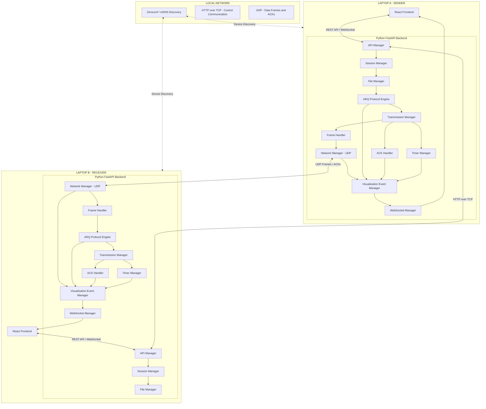

# System Architecture – File Transfer System

## 1. Architecture Overview

The application follows a **Modular Monolithic Architecture**.

The same application runs independently on both laptops. Each laptop contains:

* React frontend
* Python FastAPI backend
* Local application state
* UDP networking components
* ARQ protocol implementation

The user selects either Sender or Receiver when starting the application.

Both laptops communicate over the same local network.

### Architecture Principles

1. Both laptops run the same application code.
2. Each laptop has its own frontend and backend.
3. Frontend communicates with its local backend.
4. Backend communicates with the other laptop's backend.
5. HTTP over TCP handles control communication.
6. UDP handles actual file frames and ACKs.
7. WebSockets deliver live events to the local frontend.
8. All ARQ protocols are implemented within the backend.
9. No external database or message broker is required for the initial MVP.

---

## 2. High-Level System Architecture



---

## 3. Frontend Architecture

The frontend is developed using React and TypeScript.

### Frontend Components

| Component              | Responsibility                                             |
| ---------------------- | ---------------------------------------------------------- |
| Role Selection         | Allows user to select Sender or Receiver                   |
| Device Discovery       | Displays available devices                                 |
| Connection Manager UI  | Handles automatic discovery and manual IP + PIN connection |
| Session UI             | Displays connection status                                 |
| File Selection         | Allows sender to select files                              |
| Transfer Request UI    | Displays incoming transfer requests to receiver            |
| Protocol Configuration | Allows selection of ARQ protocol and transfer settings     |
| Transfer Visualization | Displays frames, ACKs, losses and retransmissions          |
| Transfer Progress      | Displays current transfer status and progress              |
| Transfer Report        | Displays final transfer statistics and integrity result    |

### Frontend State Management

Use Zustand to manage application state.

Suggested logical state categories:

| State Category      | Responsibility                                   |
| ------------------- | ------------------------------------------------ |
| Connection State    | Device discovery and connection status           |
| Session State       | Active session information                       |
| Transfer State      | File details, selected protocol and progress     |
| Visualization State | Frame events, ACKs, retransmissions and timeline |
| UI State            | Modals, notifications and loading states         |

The frontend should not implement ARQ logic. All protocol operations must be handled by the backend.

---

## 4. Backend Architecture

The backend uses Python and FastAPI.

All backend modules run inside a single application process on each laptop. They are logically separated modules, not independently deployed services.

### 4.1 API Manager

**Responsibility:**

* Expose REST API endpoints.
* Receive frontend commands.
* Handle connection and transfer requests.
* Communicate with the appropriate backend modules.

### 4.2 Device Discovery Manager

**Responsibility:**

* Advertise the laptop using Zeroconf.
* Discover other available devices.
* Provide discovered device information to the frontend.
* Support manual IP + PIN connection as a fallback.

### 4.3 Session Manager

**Responsibility:**

* Create and maintain transfer sessions.
* Manage sender and receiver information.
* Maintain session status.
* Associate transfers with the correct session ID.

### 4.4 File Manager

**Responsibility:**

* Read the selected file.
* Divide the file into chunks.
* Provide chunks to the protocol engine.
* Receive and organize reconstructed file data.
* Save the final received file.

### 4.5 ARQ Protocol Engine

**Responsibility:**

* Implement Stop-and-Wait, Go-Back-N and Selective Repeat.
* Manage protocol-specific sequence numbers.
* Coordinate sender and receiver window operations.
* Determine which frames should be transmitted, acknowledged or retransmitted.

Each protocol should have its own implementation while sharing common frame and networking components.

### 4.6 Transmission Manager

**Responsibility:**

* Coordinate frame transmission.
* Maintain outstanding frames.
* Manage sender and receiver windows.
* Coordinate with the ACK Handler and Timer Manager.

### 4.7 ACK Handler

**Responsibility:**

* Process incoming ACK datagrams.
* Validate ACK information.
* Update acknowledgement status.
* Notify the protocol engine about acknowledged frames.

### 4.8 Timer Manager

**Responsibility:**

* Monitor ACK timeouts.
* Detect missing acknowledgements.
* Trigger retransmission when required.
* Enforce maximum retransmission limits.

### 4.9 Network Manager

**Responsibility:**

* Create and manage UDP sockets.
* Send UDP data frames.
* Receive incoming frames and ACKs.
* Handle network communication errors.
* Support packet-loss simulation.

### 4.10 Frame Handler

**Responsibility:**

* Encode data frames.
* Decode incoming frames.
* Validate frame structure.
* Verify CRC32 checksums.
* Identify frame types and sequence numbers.

### 4.11 Integrity Manager

**Responsibility:**

* Calculate SHA-256 hash of the original file.
* Calculate SHA-256 hash of the reconstructed file.
* Compare hashes to verify file integrity.

### 4.12 Visualization Event Manager

**Responsibility:**

* Generate events from actual network and protocol operations.
* Maintain event information such as session ID, frame sequence number and timestamp.
* Forward events to the WebSocket Manager.

### 4.13 WebSocket Manager

**Responsibility:**

* Maintain frontend WebSocket connections.
* Push live transfer events to the local frontend.
* Notify the frontend about transfer progress and status changes.

---

## 5. Inter-Laptop Communication Architecture

Two types of communication are used between laptops.

### 5.1 Control Communication

**Technology:** HTTP over TCP.

Used for:

* Connection requests.
* PIN validation.
* Session establishment.
* File transfer requests.
* Transfer acceptance or rejection.
* Transfer configuration exchange.

The sender backend communicates directly with the receiver backend through HTTP APIs.

### 5.2 Data Communication

**Technology:** UDP.

Used for:

* Actual file-data frames.
* Acknowledgement frames.
* Frame retransmissions.

The sender and receiver backends implement the ARQ protocols over UDP.

The sender uses the receiver's advertised UDP port to transmit frames. The receiver sends ACKs back to the sender's UDP address.

TCP must not be used to transport the actual file payload, because the project must demonstrate its own ARQ reliability mechanisms.

---

## 6. Internal Event Flow

The Visualization Event Manager receives events from the networking and protocol modules.

The flow is:

```text
Network / Protocol Operation
             |
             v
   Visualization Event Manager
             |
             v
      WebSocket Manager
             |
             v
       Local Frontend
             |
             v
    Update Visualization
```

Example:

When the sender transmits Frame 2:

1. Protocol Engine prepares Frame 2.
2. Network Manager sends the UDP datagram.
3. A FRAME_SENT event is generated.
4. Visualization Event Manager processes the event.
5. WebSocket Manager pushes it to the sender frontend.
6. Sender frontend updates its visualization.

The receiver follows the same process when it actually receives Frame 2.

Events should be generated from real operations, not from a predefined animation timeline.

---

## 7. Deployment Architecture

The same application is installed and executed independently on both laptops.

### Laptop A

* React frontend
* FastAPI backend
* Sender role
* Local UDP networking
* ARQ protocol engine

### Laptop B

* React frontend
* FastAPI backend
* Receiver role
* Local UDP networking
* ARQ protocol engine

Both laptops execute the same source code. Their responsibilities depend on the selected role and active transfer state.

Each laptop runs its own backend process and communicates with its own frontend.

No central server is required for the initial local-network MVP.

---

## 8. Data Storage

The initial MVP does not require a database.

The following information can be maintained in backend memory:

* Active sessions.
* Connected device information.
* Current transfer details.
* Sender and receiver window state.
* Outstanding frames.
* ACK tracking.
* Transfer statistics.
* Temporary visualization event information.

Received files are saved to the receiver's local filesystem.

A database can be introduced later if persistent transfer history is required.

---

## 9. Technology Stack Mapping

| Layer                  | Technology           |
| ---------------------- | -------------------- |
| Frontend               | React                |
| Programming Language   | TypeScript           |
| Styling                | Tailwind CSS         |
| State Management       | Zustand              |
| Routing                | React Router         |
| REST API Client        | Axios                |
| Live Communication     | Native WebSocket API |
| Animation              | Motion               |
| Backend                | Python               |
| Backend Framework      | FastAPI              |
| ASGI Server            | Uvicorn              |
| Validation             | Pydantic             |
| Async Operations       | asyncio              |
| Network Communication  | Python socket        |
| Frame Encoding         | struct               |
| Device Discovery       | Zeroconf             |
| File Integrity         | hashlib              |
| Session Identification | uuid                 |
| Logging                | logging              |
| Testing                | pytest               |
| Network Inspection     | Wireshark            |

---

## 10. Architectural Constraints for Implementation

The coding agent must follow these architectural decisions:

1. Implement a modular monolithic backend, not microservices.
2. Both laptops must run the same application code.
3. Keep frontend and backend responsibilities separate.
4. Implement all three ARQ protocols in the backend.
5. Use UDP for actual file frames and ACKs.
6. Use HTTP over TCP only for control operations.
7. Use WebSockets for live visualization updates.
8. Generate visualization events from actual networking and protocol operations.
9. Use Zeroconf for automatic discovery and manual IP + PIN as fallback.
10. Keep active session and transfer state in memory for the MVP.
11. Avoid introducing a database, Redis, message broker or Docker unless a genuine requirement emerges.
12. Keep networking, protocol logic, frame handling and file management in separate logical modules.
13. Do not use TCP-based file transfer as a substitute for the custom UDP + ARQ implementation.
14. Ensure file reconstruction and SHA-256 verification happen before declaring a successful transfer.

---

## 11. Documents to Be Prepared Next

The following documents will complete the technical planning:

1. API Documentation – REST endpoints and request/response structures.
2. WebSocket Documentation – Event names and event payload structures.
3. Data Model Documentation – Session, transfer, frame and protocol state structures.
4. Implementation Plan – Development phases and task distribution.
5. Design System – To be prepared separately before frontend implementation.
